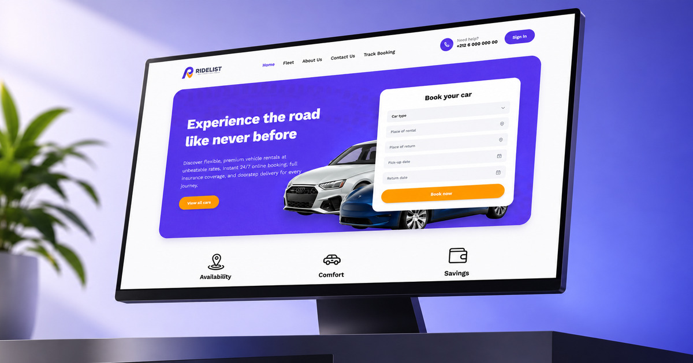

# RideList

A modern car rental platform tailored for Morocco.

  

## About

RideList is a car rental website built for Morocco. Customers can explore the fleet with real-time availability and dynamic filters, submit booking requests, and pay at vehicle pickup. Every reservation connects directly to agency staff for confirmation via WhatsApp. Visit the live platform at [https://ridelist.vercel.app](https://ridelist.vercel.app).

## Features

### Public Site
- **Fleet browsing & filters**: Search by brand, segment, transmission, fuel, seats, price range, and calendar dates.
- **Car details**: View specifications, photo gallery, per-car equipment checklist, and a "Back on" date when a car is booked today.
- **Booking requests**: Multi-step reservation modal with blocked-date calendar, pickup/drop-off locations, and optional extras.
- **Booking tracking**: Check reservation status by reference code and phone number, with direct WhatsApp contact.

### Customers
- **Optional accounts**: Email and password sign-up and sign-in.
- **Customer dashboard**: View past and upcoming booking requests with reference codes and statuses.
- **Self-service cancellation**: Cancel pending reservation requests directly from the dashboard.

### Admin Portal
- **Fleet management**: Add, edit, or hide cars, manage per-car equipment lists, and set daily rates and deposits.
- **Photo uploads**: Client-side image compression to WebP with gallery reordering and main photo selection.
- **Multi-unit inventory**: Track individual physical vehicles by license plate, with Available and Maintenance statuses.
- **Booking management**: Accept, reject, or reassign bookings, with 1-click confirmation and auto unit assignment.
- **Manual date blocks**: Block specific dates per model or unit for walk-ins or maintenance.
- **Live updates**: Real-time sync for bookings and fleet data via Supabase Realtime subscriptions.

### Under the Hood
- **Per-unit availability**: availability is calculated in the database from confirmed bookings and available units, and overlapping confirmed bookings on the same unit are rejected.
- **Row Level Security**: Database-level access policies restricting guest, customer, and admin permissions.
- **Dynamic link previews**: Open Graph and Twitter preview cards generated on demand with vehicle photo and specs.

## Built With

- **Next.js 15** (App Router)
- **TypeScript** & **React 18**
- **Tailwind CSS**
- **Supabase** (PostgreSQL, Auth, Storage & Realtime)
- **react-day-picker** & **date-fns**
- **Framer Motion**
- **Headless UI** & **FontAwesome**
- **Sharp**
