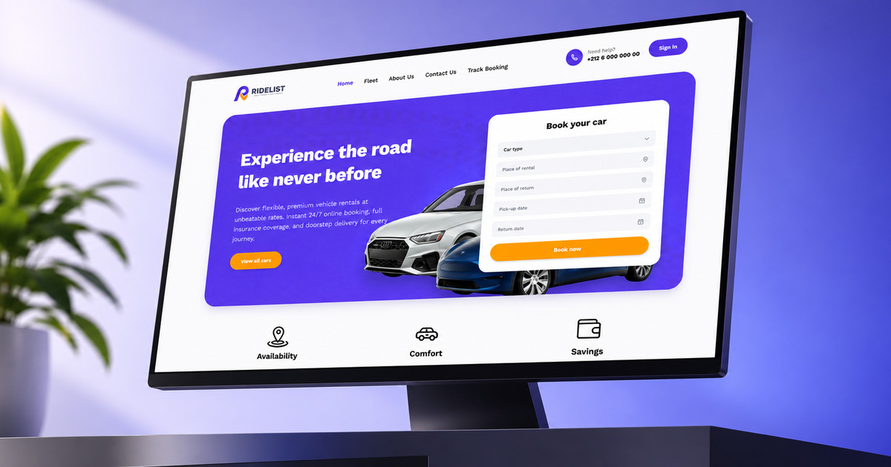

# RideList

A modern car rental platform tailored for Morocco.

  

## About

RideList is a modern car rental website built for Morocco, offering an effortless and transparent vehicle hiring experience. Customers can explore the fleet with real-time availability and dynamic filters, submit booking requests, and pay securely at vehicle pickup. Every reservation connects directly to agency staff for quick confirmation via WhatsApp. Visit the live platform at [https://ridelist.vercel.app](https://ridelist.vercel.app).

## Built With

- **Next.js 14** (App Router)
- **TypeScript** & **React 18**
- **Tailwind CSS**
- **Supabase** (PostgreSQL, Auth & Storage)
- **react-day-picker** & **date-fns**
- **Framer Motion**
- **Headless UI** & **FontAwesome**
